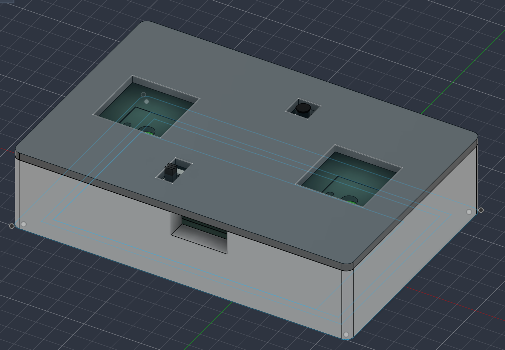
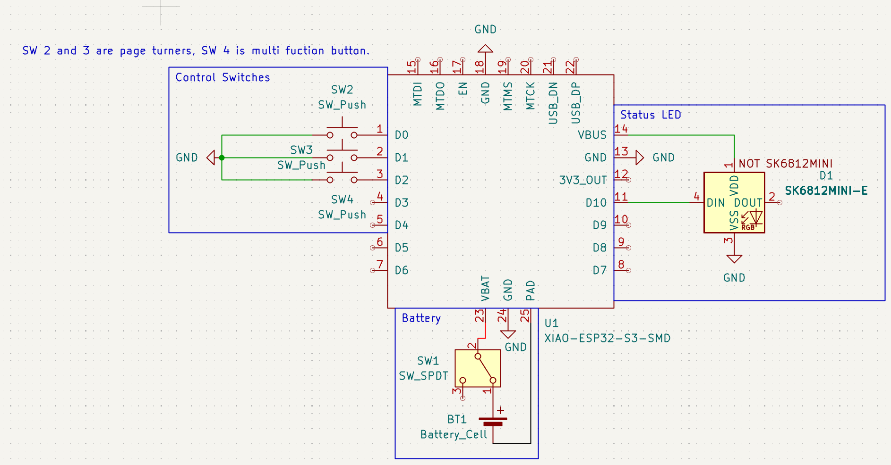
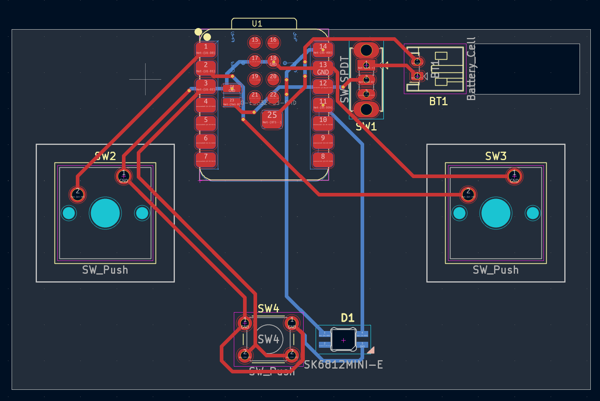
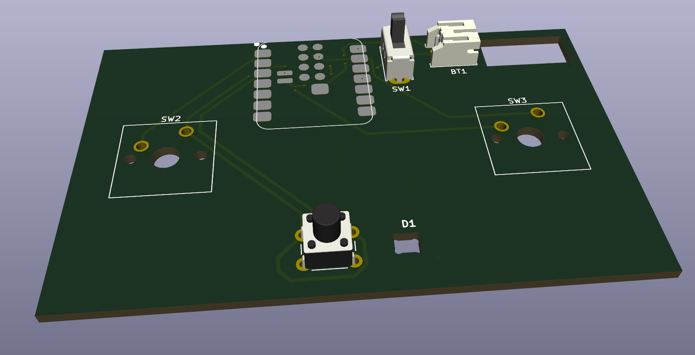

# SimplePageTurner
A simple BLE page-turner using an Xiao ESP32-S3
This project is my attempt at making a wireless page turner for musicians at a lower cost than buying one. 
It could also theoretically be used for other things, since the firmware can be modified 
Assembly:

Schematic:

PCB Design:

PCB Render:

  
Cost Breakdown: 
Parts listed in BOM + Shipping and Tariffs: $20 
PCB Costs with tax and shipping: $10 
Total: $30 
I would consider this a success for reaching my goal of making a cheaper page turner, since most are around $30, and this would be at least $10 cheaper due to the PCB, not even accounting for other components and shipping savings.
